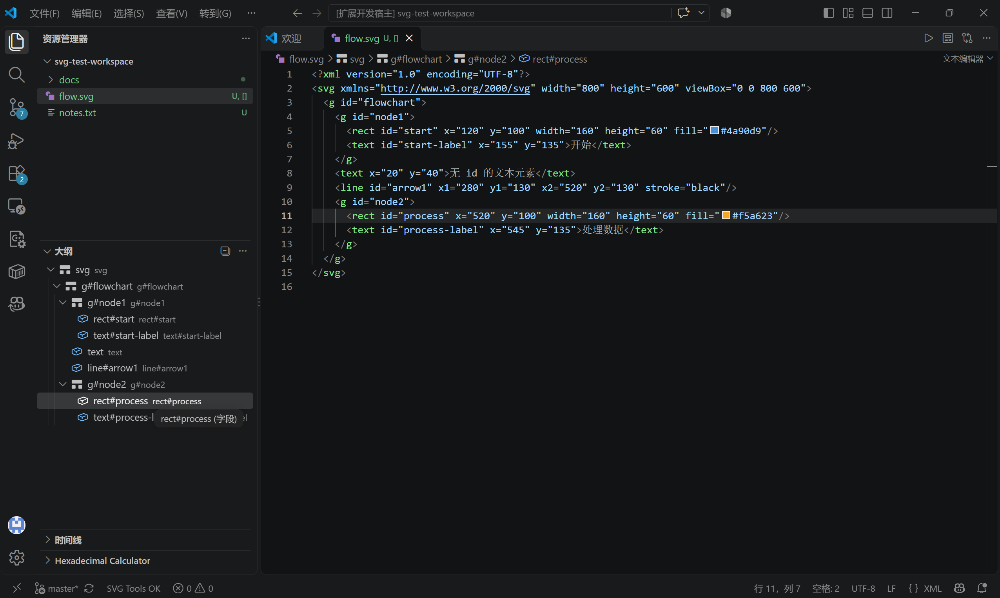
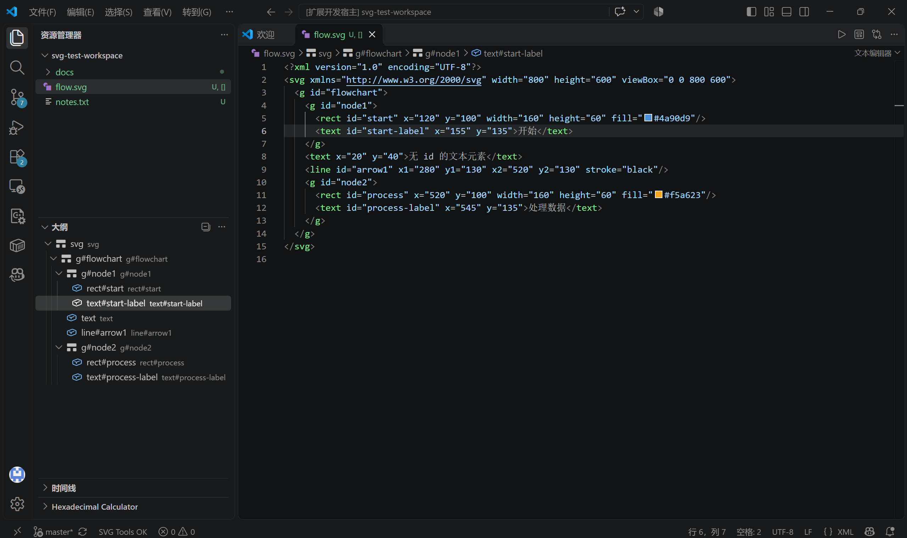
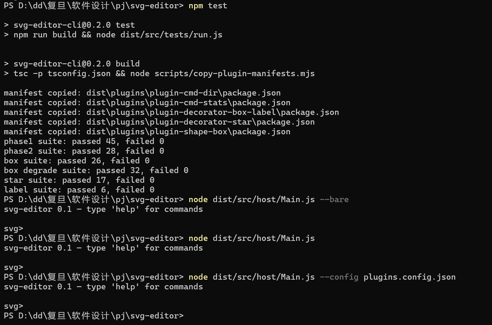
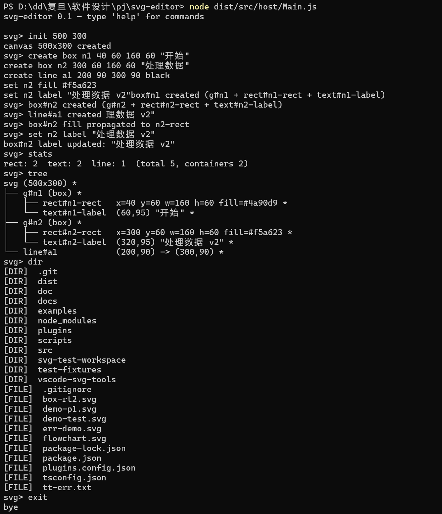

# PJ1 Phase 2 提交文档：插件实践与插件式重构

> 仓库：https://github.com/lhh010/svg-editor-cli （Phase 1 同仓库继续开发，tag 'final' 未动，本阶段收尾打 'p2'）
> 架构决策（ADR）完整版、扩展点清单与过程记录见 'doc/README.md' 的 Phase 2 部分；本文是面向评阅的独立提交文档：设计阐述 + 关键代码 + 截图 + 说明。

## 0. 总览

两部分工作：

1. **VSCode 扩展**（'vscode-svg-tools/'）：SVG 文件标记（Explorer 徽标 '[]'）+ SVG 原生大纲（层级、定位、编辑刷新、坏 XML 不崩溃）。
2. **CLI 插件式重构**：在保持 Phase 1 行为字节级不变的前提下，把图形、命令、树标签、属性行为做成四个扩展点；新增 stats / dir / box / 两个树标签五个插件；同一插件支持代码装配与配置装配两种装入方式。

仓库结构（Phase 2 新增部分加粗）：

```
svg-editor/
├── src/                    # 内核与装配
│   ├── kernel/             #   ** 四个扩展点接口 + 注册表（暂存-提交-回滚）
│   ├── builtin/            #   ** 内置六种图形的 ShapeProvider（默认装配注册）
│   ├── host/               #   ** 组合根 Main / Assembly / 配置加载器 PluginLoader
│   ├── shapes|document|commands|io|core|view|cli/   # Phase 1 内核（重构为面向接口）
│   └── tests/              # 测试入口
├── plugins/                # ** 五个可选插件包（各自 package.json 带 contributes）
│   ├── plugin-cmd-stats/   #   stats 命令
│   ├── plugin-cmd-dir/     #   dir 命令 + DirectoryAccess 适配器
│   ├── plugin-shape-box/   #   box 复合图形 + AttributeHandler
│   ├── plugin-decorator-star/      # modified-star 标签
│   └── plugin-decorator-box-label/ # (box) 类型标注标签
├── vscode-svg-tools/       # ** VSCode 扩展（独立 package.json，15 项 node 测试）
├── svg-test-workspace/     # ** 截图复现用测试工作区
├── plugins.config.json     # ** 方式 B 配置装配清单
├── docs/verification/      # ** 双装配逐字节对照产物
├── docs/metrics/           # ** 指标产出（脚本从 git 历史生成）
└── scripts/metrics.mjs     # ** 指标脚本
```

运行方式：

```
npm install
npm test                                 # 6 套件 154 项断言
node dist/src/host/Main.js               # 方式 A：代码装配（默认，全部插件）
node dist/src/host/Main.js --bare        # 仅内置能力（Phase 1 基线）
node dist/src/host/Main.js --config plugins.config.json   # 方式 B：配置装配
```

---

# 第一部分：VSCode 扩展

## 1.1 设计

扩展 = 两个"提供者"的注册与实现，宿主（VSCode）在恰当时机回调：

| 功能 | 提供者接口 | VSCode 调用时机 | 我们的实现
|-|-|-|-|
A.1 文件标记 | 'FileDecorationProvider' | 渲染 Explorer 每个资源时 | '.svg' 返回 'FileDecoration("[]")'，其余 undefined |
A.2 大纲 | 'DocumentSymbolProvider' | 大纲视图需要符号、文档变更后 | 解析全文 → DocumentSymbol 树（tag#id 命名） |

关键设计决策：**解析与建树逻辑不 import vscode**。'outline.ts' 产出纯数据 'OutlineNode'（行号/列号/嵌套），'extension.ts' 只做 vscode 类型适配——因此核心逻辑可在纯 node 环境测试（'npm test' 15 项断言），扩展层薄到只剩胶水。

## 1.2 关键代码

文件标记（'src/extension.ts'）：

```ts
class SvgFileDecorationProvider implements vscode.FileDecorationProvider {
  provideFileDecoration(uri: vscode.Uri, _token: vscode.CancellationToken) {
    if (uri.scheme === "file" && uri.path.toLowerCase().endsWith(".svg")) {
      return new vscode.FileDecoration("[]");   // 只加徽标，不改文件名与内容
    }
    return undefined;
  }
}
```

大纲——选择器覆盖常见语言关联（装没装 SVG 语言包都能命中）：

```ts
const selector: vscode.DocumentSelector = [
  { language: "svg" },
  { language: "xml", pattern: "**/*.svg" },
  { pattern: "**/*.svg" },
  { scheme: "file", pattern: "**/*.svg" },
];
vscode.languages.registerDocumentSymbolProvider(selector, new SvgOutlineProvider());
```

带位置的解析（'src/parser.ts'，Phase 1 解析器不含位置信息故不能直接复用，见 'doc/README.md' A.3.3）：每个元素记录 'start/end'（含闭合标签）与 'openTagStart/openTagEnd'（开始标签，定位目标）；任何不完整结构抛 'SvgParseError'：

```ts
export interface PosElement {
  tag: string; id: string | null;
  start: number; end: number;            // 元素全区间
  openTagStart: number; openTagEnd: number; // 点击定位目标
  children: PosElement[];
}
```

异常语义：'buildOutline' 捕获解析错误返回空数组——大纲暂时清空，扩展不崩溃；编辑过程中 VSCode 每次变更都会重新回调，语法补全后大纲自动恢复。

## 1.3 截图

大纲与定位（点击 'rect#process' 跳转高亮第 11 行；同时可见 'flow.svg' 的 '[]' 徽标）：



徽标对照（'rect#start' 高亮；'.svg' 带 '[]'，'notes.txt' 与目录不带）：



> 实测注意：宿主装了 SVG 语言扩展时 '.svg' 默认用图片预览打开，需"打开方式 → 文本编辑器"（可配置为默认）；扩展选择器已同时覆盖 'svg' 与 'xml' 语言关联。复现工作区见 'svg-test-workspace/'。

## 1.4 与模式概念的对应（摘要）

- FileDecorationProvider ≈ Decorator 的意图（给对象附加职责而不改对象），但它不包装文件、不转发调用，是宿主查询的信息提供者——"叠加"由宿主渲染层完成；
- 'OutlineNode'（纯数据）→ 'DocumentSymbol'（vscode 类型）是对象适配器：核心逻辑与 VSCode 解耦、可独立测试。


---

# 第二部分：CLI 插件式重构

## 2.1 四个扩展点：接口在内核侧

全部定义于 'src/kernel/ExtensionPoints.ts'，内核只依赖这些接口：

```ts
export interface ShapeProvider {
  readonly typeName: string;      // create <type> 的 type
  readonly tagName: string;       // 对应 SVG 标签（box 声明为 "g"）
  create(id: string, params: string[]): Shape;                // 命令构造
  parse(node: SvgElementNode, ctx: ShapeParseContext): Shape | null; // 读回认领
}

export interface CommandSpec {
  readonly name: string; readonly usage: string; readonly summary: string;
  execute(args: string[], ctx: CommandContext): string[];
}

export interface TreeDecorator {
  decorate(row: TreeRow): string | null;   // tree 行尾标签
}

export interface AttributeHandler {
  handles(shape: Shape, attr: string): boolean;
  apply(shape: Shape, attr: string, value: string, recorder: EditRecorder): AttributeApplyResult;
}
```

内核调用点（判据：内核不 import 任何插件）：

| 扩展点 | 内核调用位置 | 说明 |
|-|-|-|
ShapeProvider | 'CreateCommand.execute'（'ShapeRegistry.create/has'）；'SvgReader.parseChild'（'providersFor'，注册逆序询问，具体者优先） | 图形的构造与读回完全经注册表 |
Command | 'CommandDispatcher.handle'（先查 'CommandRegistry.find'，未命中走内置 switch） | 内置命令名是保留名，插件命令不得冲突 |
TreeDecorator | 'TreeRenderer.render → tags'（按注册顺序逐行询问） | 渲染器与内核不因新增标签而改动 |
AttributeHandler | 'SetCommand.execute'（先查 'AttributeRegistry.find'，未命中回落 Phase 1 白名单） | 'set' 内核无任何 box/fill/label 分支 |

## 2.2 注册表：暂存—提交—回滚（同一条校验路径）

'KernelRegistries.activate'（'src/kernel/Registries.ts'）是代码装配与配置装配共用的唯一入口：

```ts
activate(manifest: PluginManifest, activate: (ctx: PluginContext) => void): void {
  const scope = new PluginScope(this, manifest);
  try {
    activate(scope);   // 注册先进入暂存
    scope.commit();    // 重名检查 + contributes 清单一致性检查，通过才落入全局注册表
  } catch (e) {
    scope.rollback();  // 撤销该插件全部暂存注册；已成功的其他插件不受影响
    throw e;
  }
}
```

失败输出（主程序不退出）：'error: duplicate registration: <category>/<name>'、'error: plugin manifest mismatch: <name> (declared: …, registered: …)' 等，四类失败路径与回滚均有测试（'src/tests/phase2.test.ts'）。

## 2.3 内置图形改为插件式

'src/builtin/BuiltinShapeProviders.ts' 把 Phase 1 的 ShapeFactory 六种类型原样迁移为 ShapeProvider 集合，由默认装配激活（manifest 声明与注册一致，走同一校验路径）。**禁用全部可选插件（--bare）后输出与 final tag 基线逐字节一致**（'docs/verification/bare-cli-1.txt' vs 'doc/transcript/expected/final-cli-1.txt'，fc /B 无差异）。

读回降级：未装 box 插件时读入 '<g data-kind="box">'，内核的 GProvider 输出警告并降级为普通 g（测试覆盖）；重复 id 拒绝整个读入。

## 2.4 命令插件 stats 与 dir

stats（'plugins/plugin-cmd-stats'）：DFS 按当前顺序统计，叶子按类型首次出现顺序计数，'g'/'box' 只计入 containers；只读命令不进 undo 栈：

```ts
const walk = (shapes: readonly Shape[]): void => {
  for (const s of shapes) {
    if (s instanceof Group) { containers++; walk(s.children); }
    else { total++; counts.set(s.tag, (counts.get(s.tag) ?? 0) + 1); }
  }
};
// 输出：rect: 2  circle: 1  text: 2  (total 5, containers 1)
```

dir（'plugins/plugin-cmd-dir'）——适配器模式访问文件系统：

```ts
export interface DirectoryAccess {          // Target 依赖的接口（端口）
  readEntries(dirPath: string): DirectoryEntry[];
}
export class FsDirectoryAdapter implements DirectoryAccess {  // Adapter：适配 Node fs
  readEntries(dirPath: string) {
    return fs.readdirSync(dirPath, { withFileTypes: true })
      .map(e => ({ name: e.name, isDirectory: e.isDirectory() }));
  }
}
export class InMemoryDirectoryAccess implements DirectoryAccess { … }  // 测试替身
```

角色对应：Target = 'DirCommand'（只依赖接口）；Adaptee = Node fs；Adapter = 'FsDirectoryAdapter'。符号链接按 lstat 语义显示 '[FILE]' 不遍历目标；目录在前、文件在后、名称码点升序，输出稳定；空目录 '(empty directory)'；失败 'error: cannot read directory: <cwd>' 后仍可继续；未 init 也可用、不触碰 undo/io 锁。测试双档：替身覆盖混合/隐藏/空/失败/排序，真实临时目录验证与适配器组合（'src/tests/phase2.test.ts'）。

## 2.5 box 图形插件

'plugins/plugin-shape-box/index.ts' 三个角色：

```ts
export class BoxGroup extends Group {           // 复合容器：只依赖内核公开抽象
  get kindLabel() { return "box"; }             // echoLabel -> "box#n1"、isComposite、(box) 标签源
  protected extraAttrXml() { return ' data-kind="box"'; }  // 序列化标记
  canDetach(child) { return child !== this.rectPart && child !== this.labelPart; } // 子部件保护
  creationEcho() { return `box#${id} created (g#${id} + rect#${id}-rect + text#${id}-label)`; }
}
```

创建（模板 rect '<id>-rect' + text '<id>-label'，label 位于 (x+20,y+35)）；创建前对整棵新增子树做 id 冲突预检，冲突整条命令失败不留残迹。'ungroup' 拒绝（'cannot ungroup composite shape'）；'delete/addto/group' 摘除必要子部件被 'canDetach' 拦截（'cannot detach protected child'）；整箱 move/scale/删除、再嵌套正常。

属性处理器（fill 传播 / label 改写，全部修改经 recorder 登记）：

```ts
apply(shape, attr, value, recorder) {
  if (attr === "fill") {
    const rect = box.rectChild();
    recorder.record(rect, "fill", rect.fill);      // 撤销记录
    rect.setAttribute("fill", value);
    return { message: `box#… fill propagated to ${rect.id}`, undoMessage: … };
  }
  const label = box.labelChild();
  recorder.record(label, "text", label.content);
  label.setAttribute("text", value);
  return { message: 'box#… label updated: "…"' };
}
```

契约保证（ADR-1）：一次 'set' 一个 undo 单元（undo 逆序恢复记录、redo 重放）；处理器部分失败时 SetCommand 按记录逆序回滚并报 'error: attribute handler failed: …'，不落入默认白名单，undo/redo 历史不变（测试模拟抛错处理器验证）。读回：装插件时校验"恰好一个 rect + 一个 text"，否则拒绝整个读入；未装插件降级为普通 g 并警告。

## 2.6 树标签插件（并存、互不感知）

modified-star 的 dirty 语义 = **内容与上次保存时不一致**（ADR-3）：订阅内核事件，在 save/load 时拍快照（id → 子树序列化，实例字段保存，非模块级变量）；decorate 时逐行比较。'undo' 回到保存点 * 自动消失、'redo' 回来；从未保存视为 dirty；祖先传播由子树序列化天然成立；标签拼接顺序 = 注册顺序。

box-type-label 只依赖内核公开的 'Shape.kindLabel'，与 box 插件零依赖——未装 box 时自然无输出。

## 2.7 两种装配方式

方式 A（代码装配，默认）：'src/host/Main.ts' import 插件加入 'wiredPlugins()'。方式 B（配置装配）：'--config plugins.config.json'，加载器 'src/host/PluginLoader.ts' 按字符串模块名解析（相对路径以配置目录为基准，候选 [配置目录、dist] × [原名、.js、/index.js]），manifest 取自插件包 package.json 的 contributes 段，'enabled:false' 跳过、'options' 透传给 activate。加载器不含任何具体插件的导入/映射/分支——接入新插件零改动。

配置示例（即仓库 'plugins.config.json'）：

```json
{
  "plugins": [
    { "module": "./plugins/plugin-cmd-stats" },
    { "module": "./plugins/plugin-cmd-dir" },
    { "module": "./plugins/plugin-shape-box" },
    { "module": "./plugins/plugin-decorator-box-label" },
    { "module": "./plugins/plugin-decorator-star" }
  ]
}
```

四类失败输出且继续启动：not found / no default export / manifest mismatch / activate 抛错；另有 duplicate registration（回滚该插件）与 invalid plugin config（以默认内置能力启动）。

**判据证据**：接入各插件的提交（stats/dir '527ed74'、box 方式 A '08bd969'、box 方式 B '8978d25'、标签 'b90652a'）对内核与既有插件的 git diff 为空；双装配对 'cli-box'、'cli-plugins'、固定临时目录 'dir' 三组会话输出 fc /B 逐字节一致（'docs/verification/'）。


---

# 测试、验证与指标

## 3.1 测试套件（'npm test'，CLI 范围 154 项断言）

| 套件 | 断言 | 覆盖 |
|-|-|-|
Phase 1 回归 | 45 | 规范 §6 transcript 逐行、错误表、undo/redo、round-trip（bare 装配） |
Phase 2 插件与装配 | 28 | stats 语义与 help；dir 替身（混合/隐藏/空/失败/稳定排序）+ 真实临时目录 + 未初始化可用 + 不动 undo 历史；加载器四类失败、重复注册回滚、非法配置；A/B 一致性（含 box 会话） |
box | 26 | §6.1 版本 B 会话逐行、子部件保护、id 冲突、序列化读回、fill/label 撤销重做 |
box 降级 | 32 | 未装插件读回降级为普通 g + 警告 + 可 ungroup |
modified-star | 17 | 状态机全分支：编辑→保存→再编辑→undo→redo、load、保存点后新增 |
标签并存 | 6 | '(box)' 与 '*' 组合行、无 box 插件时的缺省行为 |

VSCode 扩展另测 15 项（'vscode-svg-tools' 目录 'npm test'，纯 node）：嵌套分组、无 id 元素、定位行号、编辑更新、四类不完整 XML 不崩溃。

截图：npm test 六套件全绿 + 三种启动形态。



## 3.2 功能演示（CLI）

一次会话同框四个插件：'create box' 一条命令创建复合图形、'set fill' 传播、'set label' 改写、'stats' 统计、'tree' 行尾 '(box)' 与 '*' 两标签并存、'dir' 列目录：



## 3.3 字节级对照

| 对照 | 结果 |
|-|-|
方式 A vs 方式 B（'doc/transcript/cli-box.txt'、'cli-plugins.txt' 会话） | fc /B 无差异（'docs/verification/A-*.txt' vs 'B-*.txt'） |
固定临时目录下 dir 双装配 | fc /B 无差异 |
--bare vs 'final' tag 基线（'doc/transcript/cli-1.txt'） | fc /B 无差异 |

## 3.4 指标（'docs/metrics/'，脚本 'node scripts/metrics.mjs final HEAD' 生成，不接受手填）

行数与圈复杂度按 内核 / 装配处(host+builtin) / 插件(plugins) 三类拆分，对比 final 与 p2；VSCode 扩展单独列出，不混入 CLI 增量。生成方式与完整数字见 'docs/metrics/metrics.md'。

## 3.5 验收清单自查

| 项 | 扩展点 | 命令插件 | box | 标签 | 双装配 |
|-|-|-|-|-|-|
接口在内核侧 | 四个齐备 | ✓ | ✓ | ✓ | — |
以类实现 | ✓ | ✓ | ✓ | ✓ | — |
不反向依赖内核实现 | ✓ | ✓ | ✓ | ✓ | ✓ loader 无插件硬编码 |
内核与既有插件差异=0 | ✓ | ✓（527ed74/08bd969/8978d25/b90652a 可复核） | ✓ | ✓ | ✓ |
禁用可选扩展的缺省行为 | 四个均有 | unknown command | 降级为普通 g | 基线逐字节不变 | — |
独立可测 | — | dir 含替身+真实双档 | 自建上下文 | 状态机独立测试 | 四条失败路径 |
插件间协作 | — | — | '(box)' 标注 | 两标签并存 | 同一插件两装法 |
输出逐字节一致 | — | — | — | — | ✓ 三组对照 |
适配器模式 | — | ✓ DirectoryAccess | — | — | ✓ 两装法共用接口 |

## 3.6 过程与 ADR 索引

- ADR-1 属性扩展点契约（命中顺序、EditRecorder、undo 单元、失败回滚）
- ADR-2 box 读回降级与校验（拒绝 vs 降级、重复 id、子部件保护策略）
- ADR-3 dirty 语义与祖先传播（内容快照、从未保存、拼接顺序）
- ADR-4 配置清单校验时机（暂存-提交、失败回滚）
- ADR-5 dir 目录访问适配器（角色对应、符号链接、稳定排序）

完整 ADR、扩展点清单（含内核调用位置与违约报错）、AI 协作检查与修正记录、重构前后依赖图：'doc/README.md' 的 Phase 2 部分。

