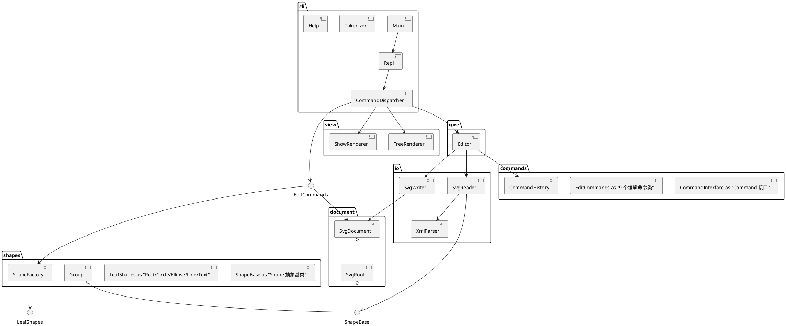
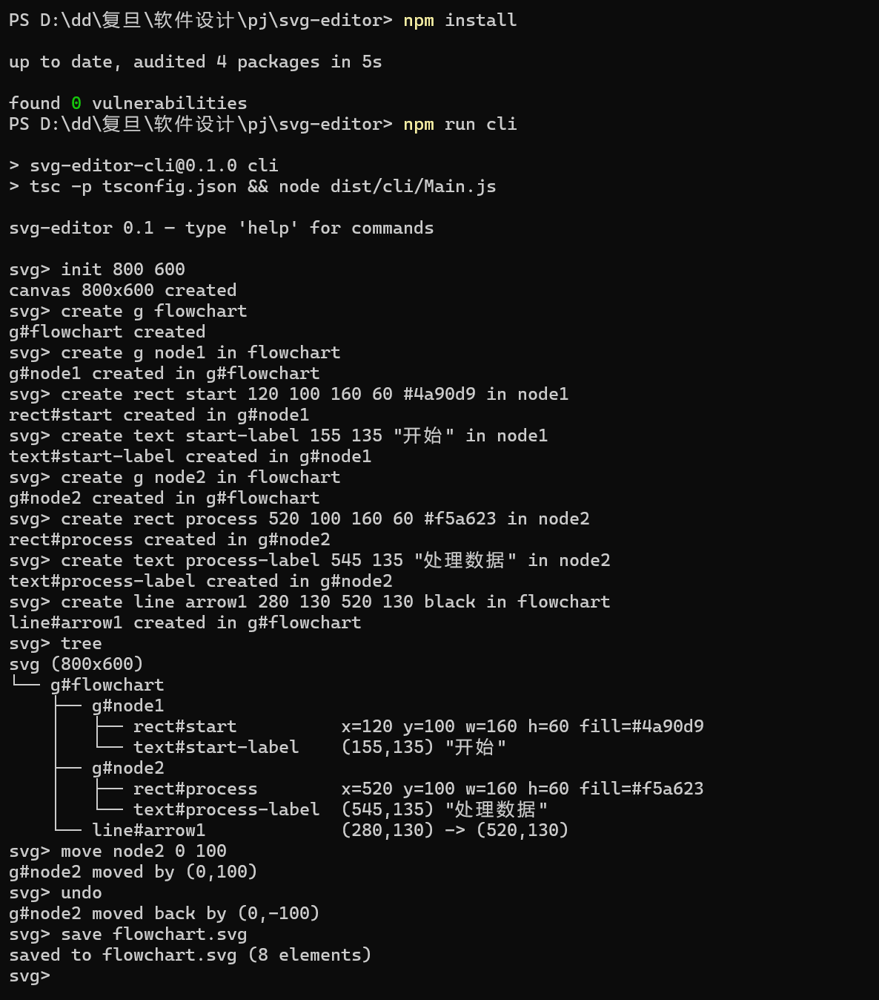
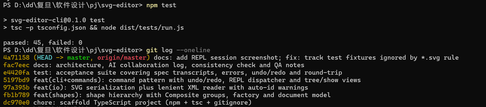
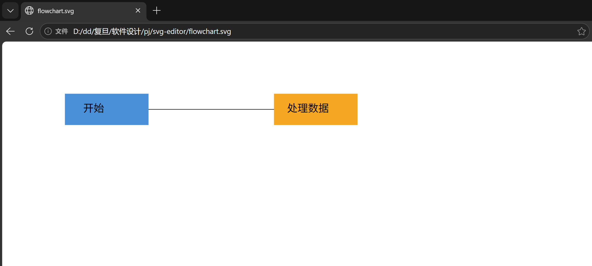
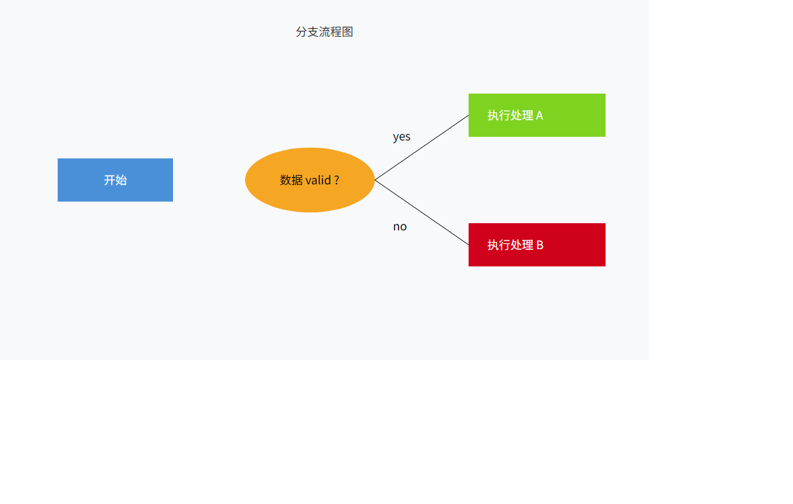
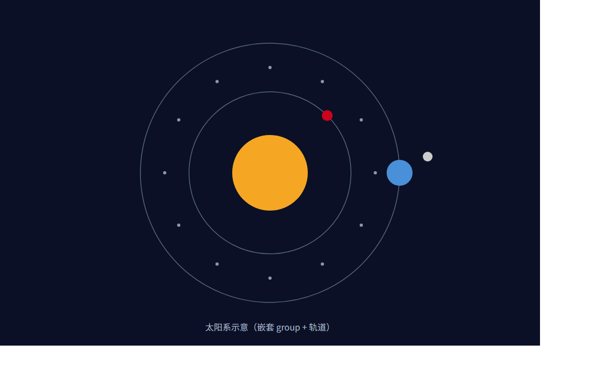
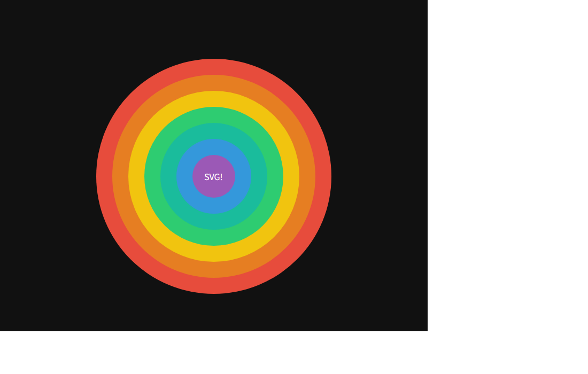

# SVG 编辑器（CLI）— PJ1 Phase 1

一个用 TypeScript + 面向对象实现的命令行 SVG 编辑器：通过 REPL 完成 SVG 文档的
创建 / 读取 / 保存，以及图形的创建、移动、缩放、分组、删除、属性修改、结构查看与撤销重做。

运行方式：

```bash
npm install
npm run cli   # 启动 REPL（svg> 提示符，help 查看全部命令）
npm test      # 验收测试（45 项断言）
```

---

## 一、架构方案

### 1.1 模块划分

代码位于 `src/` 下，按职责分为六个模块（目录），一类一文件（文件名 = 类名）：

| 模块 | 目录 | 职责 |
|-|-|-|
| **shapes** | `src/shapes/` | 图形领域模型：抽象基类 `Shape`，叶子 `Rect/Circle/Ellipse/Line/Text`，容器 `Group`（Composite），`ShapeFactory` 按类型名构造 |
| **document** | `src/document/` | 文档状态：`SvgDocument`（画布尺寸 + id 注册表 + 查找），`SvgRoot`（虚拟 svg 根），`ShapeParent`（容器侧统一接口） |
| **commands** | `src/commands/` | Command 模式落地：每条编辑命令一个类（CreateCommand、MoveCommand…），`CommandHistory` 管理 undo/redo 双栈与 io 锁 |
| **io** | `src/io/` | `SvgWriter` 序列化、`SvgReader` 宽容读入（缺 id 自动补 + 警告）、`XmlParser` 极简 XML 解析 |
| **core** | `src/core/` | `Editor` 门面：持有文档/工厂/历史，封装文档类命令与编辑命令的执行入口 |
| **cli / view** | `src/cli/`、`src/view/` | 交互层：Tokenizer 分词（双引号参数）、CommandDispatcher 命令分发、Repl 主循环、Help；TreeRenderer / ShowRenderer 纯渲染 |

组件图（PlantUML）：



### 1.2 设计模式的选择与落地

**Command（规范强制，核心模式）**

- 每条编辑命令是一个实现 `Command` 接口（execute(): string / undo(): string）的对象，
  自带"足够还原现场"的私有状态（旧父容器、旧下标、旧属性值、缩放因子等）。
- `CommandHistory` 维护 undo/redo 双栈：一条编辑命令 = 一个 undo 单元；
  `group g1 r1 c1` 整体一个单元（undo 一次还原全部）。
- io 锁：init / read / save / canvas 改尺寸后 lockIo()，undo/redo 报
  "error: undo not allowed after io command"；下一次编辑命令 push() 时重新解禁；
  init / read 额外清空双栈（文档已整体替换，旧命令快照指向失效对象）。
- 收益：新增编辑命令（如 rotate）只需新增一个 Command 类并在分发表加一行，不触碰历史管理。

**Composite（容器与叶子统一操作）**

- `Group` 与五种叶子同继承 `Shape`；moveBy / scaleBy / toXml / setAttribute 对容器
  递归传播、对叶子就地修改，命令层完全无分支——move 对 g#node2 与 rect#box 是同一段代码。
- `ShapeParent` 接口让画布根 `SvgRoot` 与 `Group` 同构，
  delete/ungroup/addto/front/back 的"挂回原处"逻辑无需区分根级与嵌套。

**Factory**：`ShapeFactory` 集中"类型名 → 构造"映射与参数校验（按名字分派的两处合法位置之一）。

**Facade**：`Editor` 把文档、工厂、历史、文件 IO 收敛为一个入口，CLI 层不直接碰这些对象。

**按名字分派的位置（规范仅允许两处，均为待重构项）**：

1. `CommandDispatcher.handle` 的 switch（命令名 → 处理逻辑）；
2. `ShapeFactory` 的注册表（类型名 → 构造器）。插件化阶段将把 2 改造为 ShapeProvider 插槽。

### 1.3 依赖方向规则

规则（上层依赖下层，同层不互相依赖，领域层不依赖 IO/CLI）：

1. `shapes` 最底层，不依赖任何其他业务模块（仅自身与 errors）；
2. `document` → `shapes`（聚合图形、管理 id）；
3. `commands` → `document + shapes`（读取/修改模型，不碰 IO 与 CLI）；
4. `io` → `document + shapes`（序列化/反序列化模型，不被领域层依赖）；
5. `core(Editor)` → `document + commands + io + shapes`（组装者，被 cli 依赖）；
6. `cli / view` 最上层 → `core + commands + document + shapes + errors`；
   cli 不直接做文件 IO（读写文件只经 Editor）。

理由：领域模型（shapes/document）稳定、被所有人依赖；易变的交互（cli）与
文件格式（io）放在外圈，替换其中之一不影响内核。反向依赖（如 shapes import io）即为违规项。

### 1.4 变化点假设

| 变化点 | 假设 | 留下的口子 |
|-|-|-|
| 新增图形类型（box 等复合插件） | 阶段 2 必然发生 | `Shape.kindLabel` 已预留（tree 显示 "g#n1 (box)"）；ShapeFactory 注册表可整体替换为 ShapeProvider 插槽；UngroupCommand 已有 "cannot ungroup composite shape" 分支；内核无需改动 |
| 交互通道扩展（GUI / agent） | CLI 只是通道之一 | 全部能力收敛在 Editor + CommandDispatcher，REPL 仅是行协议适配层；换成 WebSocket/HTTP 输入不影响命令层 |
| 文件格式变化 / 更严格的 XML | 读入宽容度可能调整 | IO 独立成模块，XmlParser 只被 SvgReader 使用，可整体换成成熟解析器而不动领域层 |
| 撤销粒度 / 历史策略变化 | 如批处理、命名快照 | 已封装在 CommandHistory 单类中，改策略不动命令类 |
| set 白名单随类型扩展 | 插件属性传播（fill → rect） | setAttribute 是多态方法而非集中 switch，插件类型可自带语义 |
| 坐标系 / transform 属性 | 本阶段不做 | **决定不留**：move/scale 采用"递归改写几何"而非 transform 属性，round-trip 语义更简单；若未来引入 transform 需改 Shape 序列化，已在文档记录此权衡 |

---

## 二、过程记录（与 AI 协作）

采用"AI 生成初稿 + 人工审查 + 场景回放验证"的迭代方式，关键节点：

1. **容器移动的实现路线之争**：AI 最初建议用 SVG 的 transform="translate(...)"
   实现容器移动（改一个属性即可）。人工审查发现问题：show/tree 需要显示"绝对几何"，
   transform 会让模型层几何与显示不一致，且 scale 规范明确要求"递归到每个子孙"。
   最终改为 **Composite 递归改写几何**，序列化不输出 transform，round-trip 语义保持简单。
   这是本次最重要的架构决策之一。
2. **根级图形收编进容器后"消失失败"bug**：联调 `group markers c1 box` 时发现
   c1、box 同时出现在根与容器中（双亲未摘除）。根因是 Group.appendChild 隐式 detach
   只能处理"旧父亲是 Group"的情形，根级图形 parent === null 时无人负责摘除。
   修复：把 appendChild/insertChildAt 改为**纯挂载**，摘除责任上移到命令层
   （命令通过 holderOf 显式摘除），"谁的孩子谁负责"变成单向规则。
3. **set 回显不符合规范**：AI 初版输出 `text#title updated: "My Diagram v2"`，
   对照规范应为 `text="My Diagram v2"`（带属性名）。建立"以规范 4.2 / 第 6 节
   transcript 为验收基准"的原则后修正，并把这两节固化为验收测试断言。
4. **tree 内联属性缺失**：初版 tree 只显示几何，漏了 fill=#ffffff。修复时
   没有直接改 geometrySummary（show 也要用它，会导致 fill 显示两遍），
   而是新增 treeSummary() 复写点——一次返工换来了更清晰的渲染分工。
5. **in 子句与 text 内容的歧义**：`create text t1 20 30 "in"` 中被引号包裹的
   "in" 不应解析为容器子句，分词器因此给 token 保留了 quoted 标记，
   仅未加引号的行尾 in 才作为子句关键字。
6. **io 锁语义**：讨论后确认 save 后 undo 被禁止、且"下一次编辑命令重新解禁"，
   init/read 额外清空双栈（文档已整体替换，旧命令的快照指向已失效对象）。

---

## 三、一致性自查

**1. 模块划分：实际目录与方案是否一致？**

一致。方案中的六个模块（shapes / document / commands / io / core / cli+view）
与仓库 `src/` 下的目录一一对应，无方案外目录，无未记录的迁移。
唯一的微调：view 从 cli 中拆出为独立目录（渲染与交互分离），在提交历史
（feat(cli+commands) 提交信息）与上表均已体现，属方案内细化而非偏离。

**2. 依赖方向：方案里的规则有没有被违反？**

抽样检查全部 import：

- `shapes/*` 仅 import shapes 内部与 errors/CliError（无 io/cli/document 反向依赖）✔
- `document/*` 仅 import shapes ✔
- `commands/*` import document + shapes + errors，无 io/cli ✔
- `io/*` import document + shapes，未被领域层 import ✔
- `core/Editor` import document + commands + io + shapes ✔
- `cli/*`、`view/*` 只依赖 core + commands + document + shapes + errors；
  文件读写仅经 Editor ✔

结论：无违规依赖。名字分派仅存在于 CommandDispatcher 与 ShapeFactory 两处，
与方案声明一致（均已标注为插件化阶段的待重构项）。

---

## 四、功能完整性与质量保证手段

**功能完整性**：命令总表全覆盖——

- 文档类：init / read（缺 id 自动补 + 警告 + 跳过不支持元素的警告）/ save（无参数回落到读入路径）/ canvas（显示与修改）；
- 编辑类：create（六种类型 + in 子句）/ delete / move / scale / set（白名单 + text 内容）/ group / ungroup / addto / front / back；
- 显示类：tree（全文档与子树、内联几何与 fill）/ show / help；
- undo / redo（一条编辑命令一个单元、redo 栈清空规则、io 锁规则）；
- 错误信息与规范 4.2 表逐条对应（含 "unknown shape type: box (is the plugin loaded?)"）。

**质量保证手段**：

1. **验收测试（npm test，45 项断言）**：驱动与 REPL 完全相同的
   Editor + CommandDispatcher 入口，逐行断言规范第 6 节两份 transcript
   （含中文文本、容器移动回显）、4.2 错误表、io 锁、ungroup 根级拒绝、
   z-order 前后与撤销、read 自动补 id 警告等。
2. **Transcript 回放**：把规范会话存成脚本管道喂给真实 CLI，逐行比对输出
   （开发中每个缺陷——双亲摘除 bug、set 回显、tree 内联 fill——都由此发现并回归）。
3. **Round-trip 检查**：save 的产物再 read 回来，tree 结构与元素数一致；
   other.svg 外部文件（含无 id 元素）读入后 tree 输出与规范示例逐字一致。
4. **严格 TypeScript**：strict 模式编译通过；一类一文件，命名即类名。
5. **git 历史**：六个提交对应真实开发增量（脚手架 → shapes → io → cli+commands → tests → docs），
   每个提交均可独立编译，体现分步推进过程。

### 运行证据

REPL 会话：按规范 6.1 版本 A 逐步构建两节点流程图（`in` 子句建层级、容器移动、undo 回显、`save` 输出 8 elements）：




验收测试：`npm test` 全部通过（45 项断言，0 失败），下方同时展示了 `git log --oneline` 的分步提交历史：



浏览器渲染验证：`save flowchart.svg` 的产物直接在浏览器中打开——蓝色"开始"节点、橙色"处理数据"节点与连线正确呈现，证明序列化输出是合法 SVG：




### 复杂场景示例

三个可回放的示例脚本见 'examples/script-*.txt'（规范第 2 节"命令序列存成脚本回放"约定的实践），通过 'cmd /c "node dist/cli/Main.js < examples/script-solar.txt"' 管道回放生成 SVG。

**分支流程图**（19 elements）：三层嵌套 group（flow → 各节点容器 → 叶子），椭圆判断节点 + 双分支连线，覆盖 'ellipse' 类型、多层 'in' 子句与 'set fill' 修改文字颜色：



**太阳系示意**（30 elements）：'solar' 内嵌 'earth-system'、'mars'、'asteroid-belt' 多个子容器；轨道用 'fill none' + 'set stroke/stroke-width' 画出无填充描边圆；12 颗小行星均匀分布在两条轨道之间的圆环上（每 30° 一颗，坐标按三角函数预计算）：



**彩虹同心圆**（9 elements）：七层同心圆验证 z-order（后创建的圆覆盖先创建的），白字居中于最小圆内（按默认 16px 字号估宽定位）：



