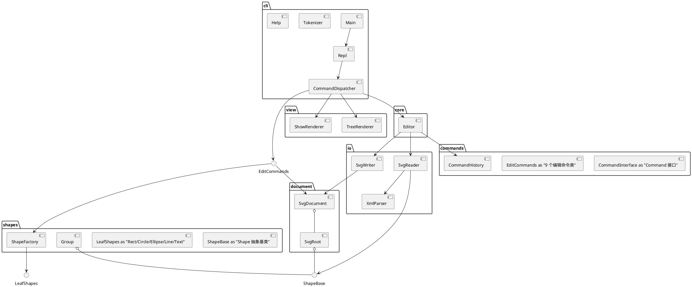
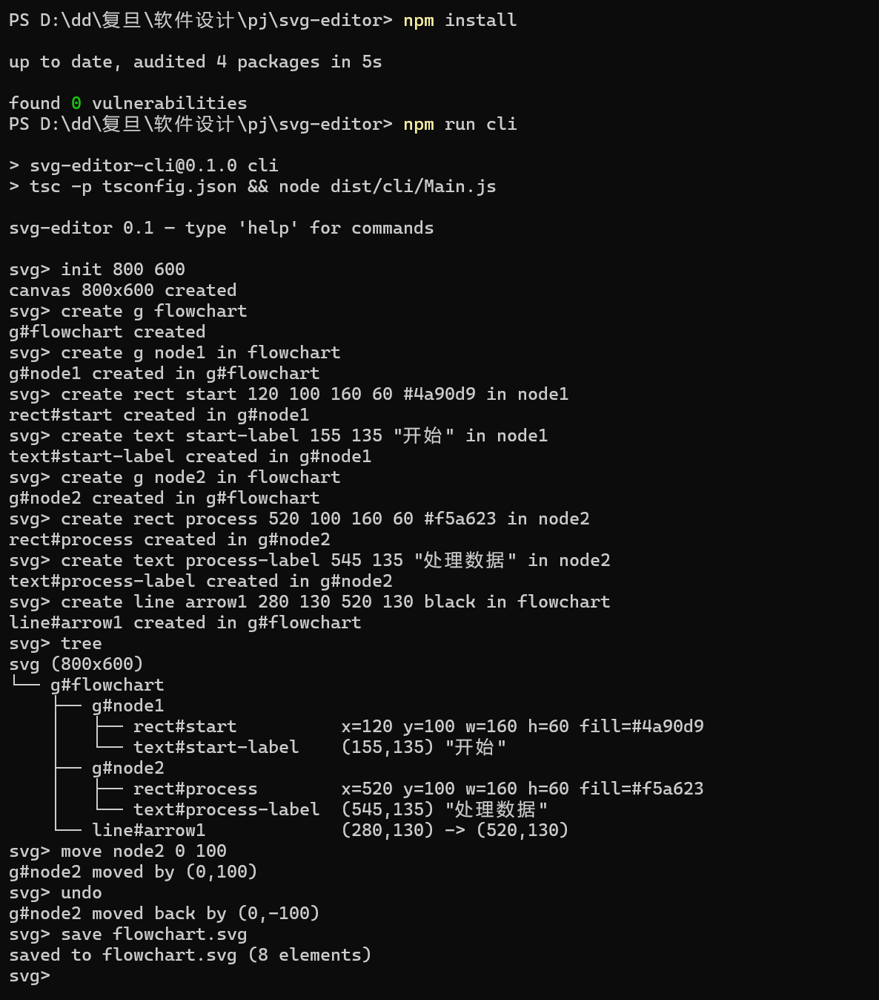
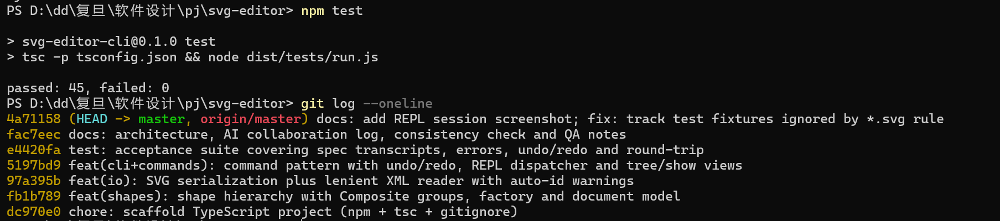
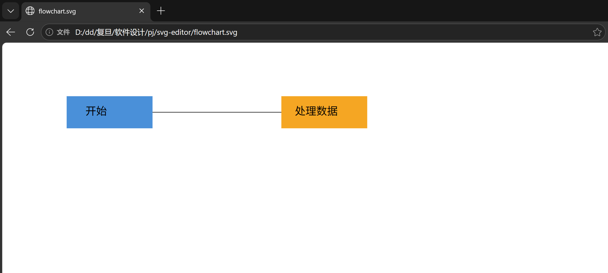
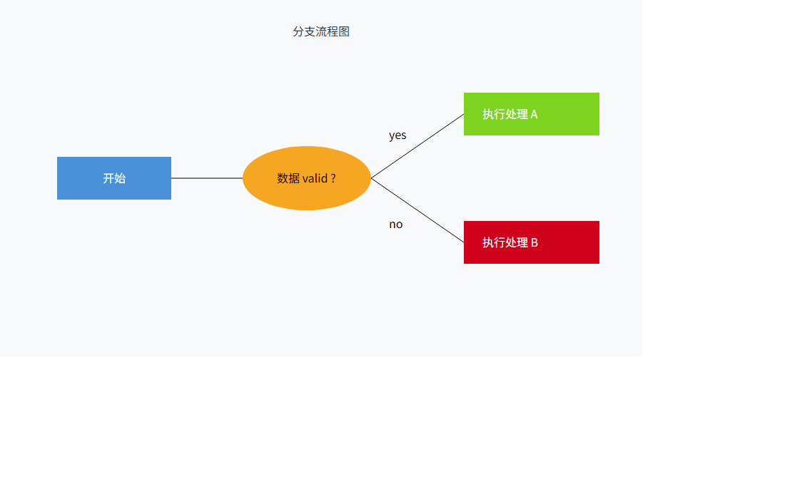
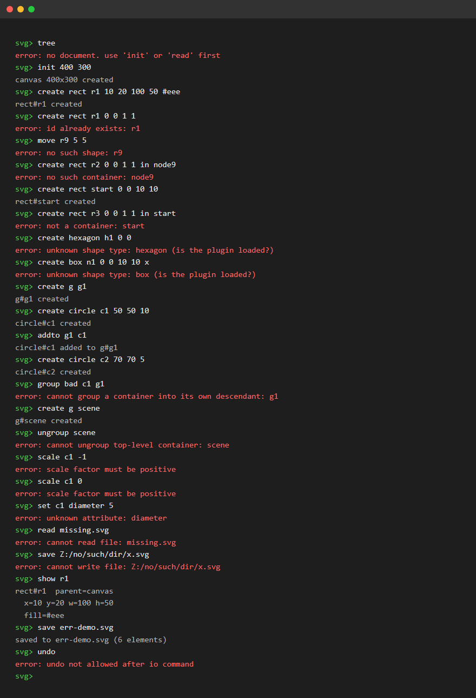
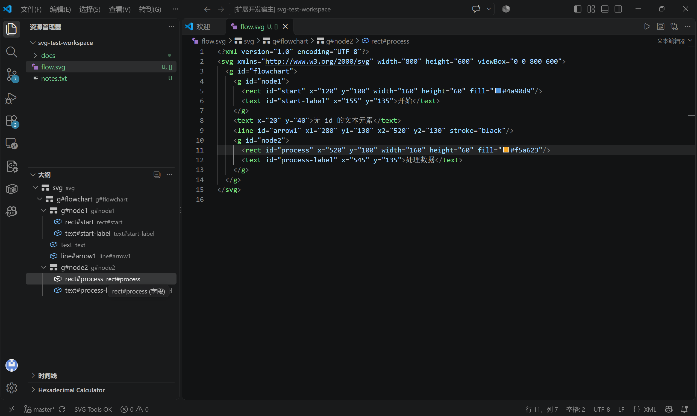
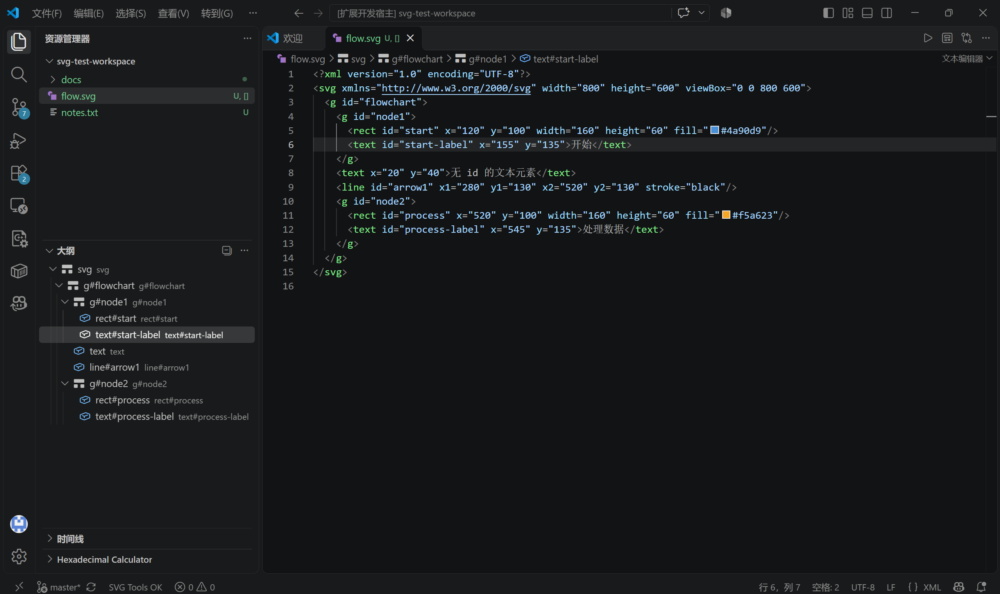

__copyright-lhh__
# 24302010010 李海豪 软件设计 lab1
## SVG 编辑器（CLI）— PJ1 Phase 1

> 仓库地址 :  [[lhh010/svg-editor-cli](https://github.com/lhh010/svg-editor-cli)](https://github.com/lhh010/svg-editor-cli)

一个用 TypeScript + 面向对象实现的命令行 SVG 编辑器：通过 REPL 完成 SVG 文档的
创建 / 读取 / 保存，以及图形的创建、移动、缩放、分组、删除、属性修改、结构查看与撤销重做。

运行方式：

```bash
npm install
npm run cli   # 启动 REPL（svg> 提示符，help 查看全部命令）
npm test      # 验收测试（45 项断言）
```

---

## 一、架构方案

### 1.1 模块划分

代码位于 `src/` 下，按职责分为六个模块（目录），一类一文件（文件名 = 类名）：

| 模块 | 目录 | 职责 |
|-|-|-|
| **shapes** | `src/shapes/` | 图形领域模型：抽象基类 `Shape`，叶子 `Rect/Circle/Ellipse/Line/Text`，容器 `Group`（Composite），`ShapeFactory` 按类型名构造 |
| **document** | `src/document/` | 文档状态：`SvgDocument`（画布尺寸 + id 注册表 + 查找），`SvgRoot`（虚拟 svg 根），`ShapeParent`（容器侧统一接口） |
| **commands** | `src/commands/` | Command 模式落地：每条编辑命令一个类（CreateCommand、MoveCommand…），`CommandHistory` 管理 undo/redo 双栈与 io 锁 |
| **io** | `src/io/` | `SvgWriter` 序列化、`SvgReader` 宽容读入（缺 id 自动补 + 警告）、`XmlParser` 极简 XML 解析 |
| **core** | `src/core/` | `Editor` 门面：持有文档/工厂/历史，封装文档类命令与编辑命令的执行入口 |
| **cli / view** | `src/cli/`、`src/view/` | 交互层：Tokenizer 分词（双引号参数）、CommandDispatcher 命令分发、Repl 主循环、Help；TreeRenderer / ShowRenderer 纯渲染 |

组件图（PlantUML）：



### 1.2 设计模式的选择与落地

**Command（规范强制，核心模式）**

- 每条编辑命令是一个实现 `Command` 接口（execute(): string / undo(): string）的对象，
  自带"足够还原现场"的私有状态（旧父容器、旧下标、旧属性值、缩放因子等）。
- `CommandHistory` 维护 undo/redo 双栈：一条编辑命令 = 一个 undo 单元；
  `group g1 r1 c1` 整体一个单元（undo 一次还原全部）。
- io 锁：init / read / save / canvas 改尺寸后 lockIo()，undo/redo 报
  "error: undo not allowed after io command"；下一次编辑命令 push() 时重新解禁；
  init / read 额外清空双栈（文档已整体替换，旧命令快照指向失效对象）。
- 收益：新增编辑命令（如 rotate）只需新增一个 Command 类并在分发表加一行，不触碰历史管理。

**Composite（容器与叶子统一操作）**

- `Group` 与五种叶子同继承 `Shape`；moveBy / scaleBy / toXml / setAttribute 对容器
  递归传播、对叶子就地修改，命令层完全无分支——move 对 g#node2 与 rect#box 是同一段代码。
- `ShapeParent` 接口让画布根 `SvgRoot` 与 `Group` 同构，
  delete/ungroup/addto/front/back 的"挂回原处"逻辑无需区分根级与嵌套。

**Factory**：`ShapeFactory` 集中"类型名 → 构造"映射与参数校验（按名字分派的两处合法位置之一）。

**Facade**：`Editor` 把文档、工厂、历史、文件 IO 收敛为一个入口，CLI 层不直接碰这些对象。

**按名字分派的位置（规范仅允许两处，均为待重构项）**：

1. `CommandDispatcher.handle` 的 switch（命令名 → 处理逻辑）；
2. `ShapeFactory` 的注册表（类型名 → 构造器）。插件化阶段将把 2 改造为 ShapeProvider 插槽。

### 1.3 依赖方向规则

规则（上层依赖下层，同层不互相依赖，领域层不依赖 IO/CLI）：

1. `shapes` 最底层，不依赖任何其他业务模块（仅自身与 errors）；
2. `document` → `shapes`（聚合图形、管理 id）；
3. `commands` → `document + shapes`（读取/修改模型，不碰 IO 与 CLI）；
4. `io` → `document + shapes`（序列化/反序列化模型，不被领域层依赖）；
5. `core(Editor)` → `document + commands + io + shapes`（组装者，被 cli 依赖）；
6. `cli / view` 最上层 → `core + commands + document + shapes + errors`；
   cli 不直接做文件 IO（读写文件只经 Editor）。

理由：领域模型（shapes/document）稳定、被所有人依赖；易变的交互（cli）与
文件格式（io）放在外圈，替换其中之一不影响内核。反向依赖（如 shapes import io）即为违规项。

### 1.4 变化点假设

| 变化点 | 假设 | 留下的口子 |
|-|-|-|
| 新增图形类型（box 等复合插件） | 阶段 2 必然发生 | `Shape.kindLabel` 已预留（tree 显示 "g#n1 (box)"）；ShapeFactory 注册表可整体替换为 ShapeProvider 插槽；UngroupCommand 已有 "cannot ungroup composite shape" 分支；内核无需改动 |
| 交互通道扩展（GUI / agent） | CLI 只是通道之一 | 全部能力收敛在 Editor + CommandDispatcher，REPL 仅是行协议适配层；换成 WebSocket/HTTP 输入不影响命令层 |
| 文件格式变化 / 更严格的 XML | 读入宽容度可能调整 | IO 独立成模块，XmlParser 只被 SvgReader 使用，可整体换成成熟解析器而不动领域层 |
| 撤销粒度 / 历史策略变化 | 如批处理、命名快照 | 已封装在 CommandHistory 单类中，改策略不动命令类 |
| set 白名单随类型扩展 | 插件属性传播（fill → rect） | setAttribute 是多态方法而非集中 switch，插件类型可自带语义 |
| 坐标系 / transform 属性 | 本阶段不做 | **决定不留**：move/scale 采用"递归改写几何"而非 transform 属性，round-trip 语义更简单；若未来引入 transform 需改 Shape 序列化，已在文档记录此权衡 |

---

## 二、过程记录（与 AI 协作）

采用"AI 生成初稿 + 人工审查 + 场景回放验证"的迭代方式，关键节点：

1. **容器移动的实现路线之争**：AI 最初建议用 SVG 的 transform="translate(...)"
   实现容器移动（改一个属性即可）。人工审查发现问题：show/tree 需要显示"绝对几何"，
   transform 会让模型层几何与显示不一致，且 scale 规范明确要求"递归到每个子孙"。
   最终改为 **Composite 递归改写几何**，序列化不输出 transform，round-trip 语义保持简单。
   这是本次最重要的架构决策之一。
2. **根级图形收编进容器后"消失失败"bug**：联调 `group markers c1 box` 时发现
   c1、box 同时出现在根与容器中（双亲未摘除）。根因是 Group.appendChild 隐式 detach
   只能处理"旧父亲是 Group"的情形，根级图形 parent === null 时无人负责摘除。
   修复：把 appendChild/insertChildAt 改为**纯挂载**，摘除责任上移到命令层
   （命令通过 holderOf 显式摘除），"谁的孩子谁负责"变成单向规则。
3. **set 回显不符合规范**：AI 初版输出 `text#title updated: "My Diagram v2"`，
   对照规范应为 `text="My Diagram v2"`（带属性名）。建立"以规范 4.2 / 第 6 节
   transcript 为验收基准"的原则后修正，并把这两节固化为验收测试断言。
4. **tree 内联属性缺失**：初版 tree 只显示几何，漏了 fill=#ffffff。修复时
   没有直接改 geometrySummary（show 也要用它，会导致 fill 显示两遍），
   而是新增 treeSummary() 复写点——一次返工换来了更清晰的渲染分工。
5. **in 子句与 text 内容的歧义**：`create text t1 20 30 "in"` 中被引号包裹的
   "in" 不应解析为容器子句，分词器因此给 token 保留了 quoted 标记，
   仅未加引号的行尾 in 才作为子句关键字。
6. **io 锁语义**：讨论后确认 save 后 undo 被禁止、且"下一次编辑命令重新解禁"，
   init/read 额外清空双栈（文档已整体替换，旧命令的快照指向已失效对象）。

---

## 三、一致性自查

**1. 模块划分：实际目录与方案是否一致？**

一致。方案中的六个模块（shapes / document / commands / io / core / cli+view）
与仓库 `src/` 下的目录一一对应，无方案外目录，无未记录的迁移。
唯一的微调：view 从 cli 中拆出为独立目录（渲染与交互分离），在提交历史
（feat(cli+commands) 提交信息）与上表均已体现，属方案内细化而非偏离。

**2. 依赖方向：方案里的规则有没有被违反？**

抽样检查全部 import：

- `shapes/*` 仅 import shapes 内部与 errors/CliError（无 io/cli/document 反向依赖）✔
- `document/*` 仅 import shapes ✔
- `commands/*` import document + shapes + errors，无 io/cli ✔
- `io/*` import document + shapes，未被领域层 import ✔
- `core/Editor` import document + commands + io + shapes ✔
- `cli/*`、`view/*` 只依赖 core + commands + document + shapes + errors；
  文件读写仅经 Editor ✔

结论：无违规依赖。名字分派仅存在于 CommandDispatcher 与 ShapeFactory 两处，
与方案声明一致（均已标注为插件化阶段的待重构项）。

---

## 四、功能完整性与质量保证手段

**功能完整性**：命令总表全覆盖——

- 文档类：init / read（缺 id 自动补 + 警告 + 跳过不支持元素的警告）/ save（无参数回落到读入路径）/ canvas（显示与修改）；
- 编辑类：create（六种类型 + in 子句）/ delete / move / scale / set（白名单 + text 内容）/ group / ungroup / addto / front / back；
- 显示类：tree（全文档与子树、内联几何与 fill）/ show / help；
- undo / redo（一条编辑命令一个单元、redo 栈清空规则、io 锁规则）；
- 错误信息与规范 4.2 表逐条对应（含 "unknown shape type: box (is the plugin loaded?)"）。

**质量保证手段**：

1. **验收测试（npm test，45 项断言）**：驱动与 REPL 完全相同的
   Editor + CommandDispatcher 入口，逐行断言规范第 6 节两份 transcript
   （含中文文本、容器移动回显）、4.2 错误表、io 锁、ungroup 根级拒绝、
   z-order 前后与撤销、read 自动补 id 警告等。
2. **Transcript 回放**：把规范会话存成脚本管道喂给真实 CLI，逐行比对输出
   （开发中每个缺陷——双亲摘除 bug、set 回显、tree 内联 fill——都由此发现并回归）。
3. **Round-trip 检查**：save 的产物再 read 回来，tree 结构与元素数一致；
   other.svg 外部文件（含无 id 元素）读入后 tree 输出与规范示例逐字一致。
4. **严格 TypeScript**：strict 模式编译通过；一类一文件，命名即类名。
5. **git 历史**：六个提交对应真实开发增量（脚手架 → shapes → io → cli+commands → tests → docs），
   每个提交均可独立编译，体现分步推进过程。

### 运行证据

REPL 会话：按规范 6.1 版本 A 逐步构建两节点流程图（`in` 子句建层级、容器移动、undo 回显、`save` 输出 8 elements）：




验收测试：`npm test` 全部通过（45 项断言，0 失败），下方同时展示了 `git log --oneline` 的分步提交历史：



浏览器渲染验证：`save flowchart.svg` 的产物直接在浏览器中打开——蓝色"开始"节点、橙色"处理数据"节点与连线正确呈现，证明序列化输出是合法 SVG：




### 复杂场景示例

三个可回放的示例脚本见 `examples/script-*.txt`（规范第 2 节"命令序列存成脚本回放"约定的实践），通过 `cmd /c "node dist/cli/Main.js < examples/script-solar.txt"` 管道回放生成 SVG。

**分支流程图**（20 elements）：三层嵌套 group（flow → 各节点容器 → 叶子），椭圆判断节点 + 主干连线与双分支线，覆盖 `ellipse` 类型、多层 `in` 子句与 `set fill` 修改文字颜色：



**太阳系示意**（30 elements）：`solar` 内嵌 `earth-system`、`mars`、`asteroid-belt` 多个子容器；轨道用 `fill none` + `set stroke/stroke-width` 画出无填充描边圆；12 颗小行星均匀分布在两条轨道之间的圆环上（每 30° 一颗，坐标按三角函数预计算）：


**彩虹同心圆**（9 elements）：七层同心圆验证 z-order（后创建的圆覆盖先创建的），白字居中于最小圆内（按默认 16px 字号估宽定位）：


### 错误信息演示（规范 4.2 对照）

以下 transcript 由真实程序输出捕获（回放脚本见 `examples/script-errors.txt`，管道方式 `cmd /c "node dist/cli/Main.js < examples/script-errors.txt"`），逐条覆盖规范 4.2 的错误信息约定（终端输出截图，错误行红色标注）：

```text
svg> tree
error: no document. use 'init' or 'read' first
svg> init 400 300
canvas 400x300 created
svg> create rect r1 10 20 100 50 #eee
rect#r1 created
svg> create rect r1 0 0 1 1
error: id already exists: r1
svg> move r9 5 5
error: no such shape: r9
svg> create rect r2 0 0 1 1 in node9
error: no such container: node9
svg> create rect start 0 0 10 10
rect#start created
svg> create rect r3 0 0 1 1 in start
error: not a container: start
svg> create hexagon h1 0 0
error: unknown shape type: hexagon (is the plugin loaded?)
svg> create box n1 0 0 10 10 x
error: unknown shape type: box (is the plugin loaded?)
svg> create g g1
g#g1 created
svg> create circle c1 50 50 10
circle#c1 created
svg> addto g1 c1
circle#c1 added to g#g1
svg> create circle c2 70 70 5
circle#c2 created
svg> group bad c1 g1
error: cannot group a container into its own descendant: g1
svg> create g scene
g#scene created
svg> ungroup scene
error: cannot ungroup top-level container: scene
svg> scale c1 -1
error: scale factor must be positive
svg> scale c1 0
error: scale factor must be positive
svg> set c1 diameter 5
error: unknown attribute: diameter
svg> read missing.svg
error: cannot read file: missing.svg
svg> save Z:/no/such/dir/x.svg
error: cannot write file: Z:/no/such/dir/x.svg
svg> show r1
rect#r1  parent=canvas
  x=10 y=20 w=100 h=50
  fill=#eee
svg> save err-demo.svg
saved to err-demo.svg (6 elements)
svg> undo
error: undo not allowed after io command
```



要点说明：

- **错误不改变状态**：全部报错之后 `show r1` 证明文档完好如初，成功命令穿插于错误之间互不影响；
- **io 锁**：save 之后 undo 被拒绝；scale 的 0 与负数同样被拒绝；
- 4.2 表中 `cannot ungroup composite shape` 一条需要阶段 2 的 box 插件才能触发（UngroupCommand 中已预留该分支），本阶段 create box 即被拒绝，符合阶段边界约定。


---

# Phase 2：插件实践与插件式重构

## 第一部分：VSCode 扩展（vscode-svg-tools/）

### 使用方式

见 `vscode-svg-tools/README.md`：`npm install && npm run compile` 后用 VSCode 打开该目录按 F5 启动扩展开发宿主验证；解析与大纲构建逻辑（`src/parser.ts`、`src/outline.ts`）不依赖 vscode 模块，`npm test` 在纯 node 环境运行 15 项断言（嵌套分组、无 id 元素、编辑更新、不完整 XML 不崩溃）。


### 运行截图（A.1 / A.2）

**A.2 大纲与源码定位**（扩展开发宿主中打开 'svg-test-workspace/flow.svg'）：左侧 Outline 显示 'svg → g#flowchart → g#node1/node2 → 叶子' 的嵌套层级，无 id 的 'text' 元素仅显示标签名；点击大纲中的 'rect#process'，编辑器定位并高亮第 11 行开始标签；右侧资源管理器同时可见 'flow.svg' 的 '[]' 徽标：



**A.1 徽标对照**：另一次定位（'rect#start' 高亮于第 6 行）——'.svg' 文件带 '[]' 标记，'notes.txt' 与目录不带：



> 注：宿主机器装有 SVG 语言扩展（语言模式 'svg'）且默认用图片预览打开——扩展的选择器已覆盖 'svg'/'xml' 语言关联，验证时以"打开方式 → 文本编辑器"查看源码即可。

### A.3.1 VSCode 与插件各自的职责

VSCode（宿主）负责：窗口与视图（Explorer、Outline 面板）、文档模型与编辑事件、扩展进程管理与 API 暴露（`vscode` 模块）、在恰当时机**回调**插件注册的提供者。插件负责：实现具体的提供者接口并在 activate 时注册——本扩展注册两个：

- `FileDecorationProvider`（A.1 徽标）：VSCode 渲染 Explorer 每个资源时回调 `provideFileDecoration(uri)`，插件对 `.svg` 返回 `FileDecoration("[]")`，其余返回 undefined（无装饰）。文件名与内容都不被修改。
- `DocumentSymbolProvider`（A.2 大纲）：VSCode 在大纲视图需要符号时回调 `provideDocumentSymbols(document)`，插件解析 `document.getText()` 返回符号树；每次文档变更后 VSCode 重新回调，大纲随之更新；解析失败返回空数组，扩展不崩溃。

注册即"插件向 VSCode 声明能力"，回调即"VSCode 在恰当时机调用能力"——插件从不主动驱动 UI。这与第二部分 CLI 的扩展点方向一致：宿主定义接口与调用时机，插件只填实现。

### A.3.2 FileDecoration 与 Decorator/Adapter 模式的对应与差异

- 与 **Decorator** 的对应：FileDecorationProvider 给文件条目"附加职责"（附加徽标信息）而不改动被装饰对象（文件本身）——这正是 Decorator 意图的运行时形态。提供者的返回值在 VSCode 内部与图标、Git 状态等其它装饰信息叠加渲染，相当于动态组合的多层装饰。
- 与 Decorator 的差异：经典 Decorator 持有被装饰对象的引用并转发调用（接口一致、可透明嵌套）；FileDecorationProvider 不包装文件对象、不转发任何操作，只是被宿主查询的**信息提供者**。它更像 Strategy（装饰算法的策略）+ 观察者式回调的组合，而非透明包装链。若严格实现经典 Decorator，需要为文件条目构造"条目 + 徽标"的包装对象链；VSCode 选择了数据提供模型，把"叠加"职责收归宿主渲染层。
- 与 **Adapter** 的关系：`outline.ts` 的 `OutlineNode`（纯数据）经 `extension.ts` 适配为 `vscode.DocumentSymbol`（含 Range/SymbolKind），是典型的对象适配器——把"与 VSCode 无关的大纲逻辑"适配到 VSCode 的符号接口，从而使核心逻辑可在 node 中独立测试。

### A.3.3 Phase 1 代码复用评估

| Phase 1 模块 | 可否复用 | 原因 |
|-|-|-|
| `src/io/XmlParser` | 部分可复用 | 解析策略（宽容扫描、属性双引号）可直接移植；但它不携带源码**位置信息**，而大纲定位必须输出行列区间，故扩展内实现了带位置的 `parser.ts`（策略同源、接口不同） |
| `src/shapes` 领域模型 | 不复用 | Composite 模型面向"编辑操作"（move/scale/setAttribute），不含源码位置与文本节点；大纲需要的是轻量语法树 |
| 遍历逻辑（TreeRenderer 的 DFS） | 语义可参考 | 大纲树构建同样按 DFS 展开 children，但产出类型（DocumentSymbol）与剪枝规则不同 |
| CLI 命令/历史 | 不相关 | 扩展不做编辑，只读展示 |

结论：核心可复用的是**解析的宽容策略与树的遍历语义**，而非代码本体；位置信息缺失是 Phase 1 解析器无法直接复用的根本原因（Phase 1 的模型按"几何值"消费 XML，天然丢弃位置）。


## 第二部分：CLI 插件式重构

### 扩展点清单

四个扩展点接口全部定义在内核侧 `src/kernel/ExtensionPoints.ts`，内核（src/kernel、src/shapes、src/document、src/commands、src/io、src/core、src/view、src/cli）只依赖这些接口，不依赖任何插件实现。

| 扩展点 | 接口（文件） | 职责 | 内核调用位置（文件 / 函数） | 已有实现 | 禁用该类可选插件时的缺省行为 | 实现违约时框架如何报错 |
|-|-|-|-|-|-|-|
| ShapeProvider | `ShapeProvider`（ExtensionPoints.ts） | 提供一种图形类型：create 解析命令参数构造图形；parse 认领并读回 SVG 节点（注册逆序询问，具体者优先） | `src/commands/CreateCommand.execute`（经 `ShapeRegistry.create/has`）；`src/io/SvgReader.parseChild`（经 `providersFor`） | 内置六种（`src/builtin/BuiltinShapeProviders.ts`，默认装配注册）；box（`plugins/plugin-shape-box`） | 仅内置六种图形可用；`create box` 报 `error: unknown shape type: box (is the plugin loaded?)`；读回 data-kind 无对应插件时 GProvider 降级为普通 g 并警告 | 参数错误抛 CliError（命令层输出 error: 前缀，状态不变）；读回校验失败抛错→整份文件读入被拒绝（`cannot read file`） |
| Command | `CommandSpec`（ExtensionPoints.ts） | 提供一条命令：name/usage/summary 由插件给出，execute 返回输出行 | `src/cli/CommandDispatcher.handle`（先查 `CommandRegistry.find`，未命中走内置 switch） | stats、dir（`plugins/plugin-cmd-stats`、`plugins/plugin-cmd-dir`） | help 无 plugin commands 段；执行报 `error: unknown command: <name>` | execute 抛 CliError 由 REPL 输出；与内置命令或已注册插件重名在 scope 提交时报 `error: duplicate registration: commands/<name>` 并回滚该插件全部暂存注册 |
| TreeDecorator | `TreeDecorator`（ExtensionPoints.ts） | 为 tree 的行尾追加标签；状态封装在插件实例字段 | `src/view/TreeRenderer.render / tags`（按注册顺序逐行询问 decorate） | modified-star、box-type-label（`plugins/plugin-decorator-star`、`plugins/plugin-decorator-box-label`） | 无任何标签，tree 输出与 Phase 1 基线**逐字节一致**（已验证，见验证材料） | decorate 抛错会使 tree 命令输出 error: 前缀信息，文档状态不变；注册名重复同上回滚 |
| AttributeHandler | `AttributeHandler` + `EditRecorder`（ExtensionPoints.ts） | 定义"在某类图形上设置某属性"的领域语义（如 box 的 fill/label）；全部修改须经 recorder 登记 | `src/commands/SetCommand.execute`（先查 `AttributeRegistry.find`，未命中回落 Phase 1 白名单 `shape.setAttribute`） | box-attributes（box 插件内 `BoxAttributeHandler`） | 无处理器时按 Phase 1 白名单修改，未定义属性报 `error: unknown attribute: <attr>` | apply 抛错时 SetCommand 按已登记记录**逆序回滚**，输出 `error: attribute handler failed: <reason>`，undo/redo 历史不变（有测试） |

注册与校验统一入口：`KernelRegistries.activate`（`src/kernel/Registries.ts`）——暂存 scope 上执行 activate，提交时做重名检查与 contributes 清单一致性检查，任一失败即撤销该插件全部暂存注册并抛 AssemblyError。

### 插件装配方式

两种方式共用同一条注册与校验路径（`KernelRegistries.activate`），差别只在最外层谁实例化插件：

**方式 A（代码装配，默认）**：组合根 `src/host/Main.ts` import 插件并加入 `wiredPlugins()` 数组，经 `activatePlugin` 激活；类型检查完整。

**方式 B（配置装配，--config plugins.config.json）**：加载器 `src/host/PluginLoader.ts` 按配置解析模块并激活，运行源码一行不动即可接入新插件。配置格式：

```json
{
  "plugins": [
    { "module": "./plugins/plugin-cmd-stats" },
    { "module": "./plugins/plugin-shape-box", "options": { "any": "passed to activate" } },
    { "module": "./plugins/plugin-export-png", "enabled": false }
  ]
}
```

加载契约：
- 相对路径以配置文件目录为基准，依次尝试 [配置目录、配置目录/dist] × [原名、原名.js、原名/index.js]（tsc 把 plugins/ 编译到 dist/plugins/，构建脚本会把各插件 package.json 复制进去）；包名走 Node 模块解析；options 整体作为 activate 第二参传入（本仓库插件未使用，契约保留）。
- 按数组顺序加载；`enabled: false` 完全跳过；contributes 四类名称列表（shapes/commands/decorators/attributes）与实际注册逐类比较。
- 四类失败输出且**继续启动**：`error: plugin not found: <module>` / `error: plugin has no default export: <module>` / `error: plugin manifest mismatch: <name> (declared: …, registered: …)` / `error: plugin failed to activate: <name> (<reason>)`；重复注册输出 `error: duplicate registration: <category>/<name>` 并回滚该插件暂存注册；配置语法/结构非法输出 `error: invalid plugin config` 并以默认内置能力启动；模块存在但求值失败按激活失败处理，不误报 not found（均有测试覆盖）。
- 加载器不硬编码任何具体插件：接入新插件只须把包放进 plugins/ 并在配置加一行（本仓库 box/stats/dir/标签全部如此接入，加载器零改动）。

**验证**：`docs/verification/` 存放双装配对同一输入会话的完整输出（cli-box、cli-plugins），fc /B 逐字节一致；固定临时目录下 dir 的双装配输出亦逐字节一致；禁用全部可选插件（--bare）后 Phase 1 会话输出与 final tag 基线逐字节一致（`doc/transcript/expected/final-cli-1.txt`）。


### ADR（架构决策记录）

**ADR-1 属性扩展点契约（AttributeHandler）**

- 接口在 Phase 2 给出的骨架上完善为 `handles(shape, attr)` + `apply(shape, attr, value, recorder)`：处理器通过参数直接拿到目标图形（内核定位），用 `instanceof BoxGroup` 判断类型、用图形公开方法（rectChild/labelChild + setAttribute）修改子部件——字段保持封装。
- 多处理器同时命中：按**注册顺序取第一个** handles 为真者，后注册者不参与；冲突在注册期就被清单/重名检查约束，不发生未定义覆盖。
- 一次 set 一个 undo 单元：处理器每次成功修改一个属性前调用 `recorder.record(shape, attr, oldValue)`；SetCommand 保存记录数组，undo 逆序恢复（旧值为 null 走 clearAttribute），redo 重放 apply。
- 部分修改后抛错：SetCommand 捕获异常，按已登记记录逆序回滚，输出 `error: attribute handler failed: <reason>`，不落入默认白名单路径，undo/redo 历史保持命令执行前的状态（phase2 测试模拟了抛错处理器验证文档与历史均不变）。
- 处理器路径与默认路径的回显格式可由处理器提供（message/undoMessage），box 的 `fill propagated`、`label updated/restored` 与 Phase 1 示例一致。

**ADR-2 box 读回降级与校验**

- 序列化：`g data-kind="box"` + 子部件（复用内核 Group 的 extraAttrXml 钩子）。
- 读回已装插件：要求恰好一个 rect 与一个 text 子部件（顺序任意）；缺失或类型错误**拒绝整个读入**（不生成不完整的 box 对象），输出 `error: cannot read file: …`，原文档保持。任意位置重复 id 同样拒绝整个读入（全局唯一性不能靠降级消除）。
- 读回未装插件：内核 GProvider 降级为普通 g 并输出警告（功能不损、语义降级），此后可正常 ungroup（测试覆盖）。
- 子部件 id 沿用 `<id>-rect` / `<id>-label`；创建前对整棵新增子树做 id 冲突预检，冲突则整条命令失败不留残迹（测试覆盖）。
- 不变量保护：模板 rect/text 是受保护子部件（Group.canDetach 钩子），delete/addto/group 摘除它们时报 `error: cannot detach protected child: <id>`；整箱 delete/move/scale 以及在 box 内继续嵌套（create … in n1）不受限；move/scale 单独作用于子部件不破坏存在性不变量，允许（会破坏视觉对齐，属用户责任）。

**ADR-3 dirty 语义与祖先传播（modified-star）**

- dirty 判定按**内容与上次保存时不一致**（比较该行子树的序列化文本）：undo 回到保存点后 * 自动消失（测试覆盖 编辑→保存→再编辑→undo 分支）；redo 后 * 回来。
- 从未保存（init 后未 save/read）：所有行视为 dirty（含画布行），因为不存在保存点。
- 保存点之后新增的图形：快照中无对应条目，标 *。
- 祖先传播：子图形变化使其所有祖先的子树序列化同时变化，祖先行天然标 *，无需单独维护集合。
- 多标签拼接顺序 = 装配（注册）顺序，空格分隔；两个标签互不感知、状态互不干扰（label 测试验证 `(box) *` 与 `g#n1 (box)` 等组合行）。

**ADR-4 配置清单校验时机**

- 采用**暂存-提交**两段式：activate 在 scope 上登记，全部登记完成后统一做（a）同类及跨类重名、保留命令名检查，（b）contributes 声明与实际注册逐类比较；任一失败撤销该插件全部暂存注册（含此前已暂存的部分），已成功的其他插件不受影响，加载继续。
- 校验放在提交期而非每次 register 调用时：保证"清单不一致→整体回滚"的原子性，也避免 activate 中途因顺序问题误报。
- contributes 缺省为空（不声明则不校验类别内容，但重名检查始终执行）；声明与注册均做去重与排序后比较，避免顺序噪声。

**ADR-5 dir 的目录访问适配器**

- 角色：Target = `DirCommand`（只依赖 `DirectoryAccess` 接口）；Adaptee = Node fs（readdirSync + Dirent）；Adapter = `FsDirectoryAdapter`（把 fs 的返回适配为 `{name, isDirectory}[]`）；测试替身 `InMemoryDirectoryAccess` 让命令逻辑独立于真实文件系统。
- 符号链接：readdir 的 Dirent 按 lstat 语义，symlink 的 isDirectory 为 false，因此一律按 `[FILE]` 显示、不遍历其目标（文档化决策）。
- 排序稳定：目录在前、文件在后，各组内名称按码点升序（非 localeCompare，避免环境差异破坏"同一输入输出稳定"的要求）；空目录输出 `(empty directory)`；读取失败输出 `error: cannot read directory: <cwd>` 后 CLI 仍可用；dir 不依赖文档、不进 undo 栈、不触发 io 锁（测试覆盖）。
- 两种装配使用同一个 `DirectoryAccess` 接口与同一个 `DirCommand` 实现（配置装配经插件 default export 拿到同一类实例）。

### 重构前后的模块依赖（PlantUML）

重构前（Phase 1）：`Main → Repl → CommandDispatcher → Editor → ShapeFactory/SvgReader/TreeRenderer`，图形类型、命令全部硬编码在内核路径上。

```plantuml
@startuml
package "重构后（Phase 2）" {
  [host/Main + Assembly + PluginLoader] as Host
  package "kernel（内核）" {
    [kernel/ExtensionPoints（四个扩展点接口）]
    [kernel/Registries（注册表+scope 校验）]
    [shapes/document/commands/io/core/view/cli]
  }
  package "builtin（内置插件，默认装配注册）" {
    [六种图形 ShapeProvider]
  }
  package "plugins/（可选插件包）" {
    [plugin-cmd-stats]
    [plugin-cmd-dir（DirectoryAccess 适配器）]
    [plugin-shape-box（+AttributeHandler）]
    [plugin-decorator-star]
    [plugin-decorator-box-label]
  }
  Host --> kernel/ExtensionPoints
  Host --> builtin
  Host --> plugins
  builtin --> kernel/ExtensionPoints
  plugins --> kernel/ExtensionPoints
  kernel/... --> kernel/Registries
  kernel/Registries --> kernel/ExtensionPoints
}
@enduml
```

依赖方向规则：插件与内置实现只依赖内核公开抽象（ExtensionPoints 接口、Shape/Group 领域类、CliError），**不得** import 内核内部实现细节或 `src/host`（装配模块）；反向（内核 import 插件）为 0——接入 box/stats/dir/标签的各次提交对内核与既有插件的 git diff 为空（判据命令见过程提交历史）。

### Phase 1 → Phase 2 架构对比

| 维度 | Phase 1 | Phase 2 |
|-|-|-|
| 图形类型 | ShapeFactory 注册表硬编码六种 | ShapeProvider 扩展点；内置六种改为默认装配注册；box 零内核改动接入 |
| 命令 | Dispatcher switch 内置全集 | 内置 switch 保留 + CommandRegistry 扩展；stats/dir 以插件接入并出现在 help |
| set 属性 | 各类 setAttribute 白名单 | AttributeHandler 优先（领域语义），白名单回落；一次 set 一个 undo 单元、失败回滚 |
| tree 展示 | 固定格式 | TreeDecorator 行尾标签；基线（无标签）输出逐字节不变 |
| 读回 | 按标签 switch 构造 | Provider 认领（注册逆序）；data-kind 无插件时降级 + 警告 |
| 装配 | 无（单一入口） | 组合根代码装配 / plugins.config.json 配置装配，同一注册校验路径 |
| 复合图形 | 预留 kindLabel | box 插件落地：模板、保护、传播语义、round-trip |

### 测试与验证材料索引

- `npm test`：六个套件共 154 项断言——Phase 1 回归（45）、Phase 2 插件与装配（28，含加载器四条失败路径、重复注册回滚、非法配置、A/B 一致性）、box（26 + 降级 32）、modified-star 状态机（17）、标签并存（6）；`vscode-svg-tools` 另有独立 node 测试 15 项。
- `doc/transcript/`：会话输入（cli-1 / cli-box / cli-plugins，仅命令与注释）与 final 基线期望输出。
- `docs/verification/`：双装配逐字节对照产物（A-cli-*.txt vs B-cli-*.txt）与 --bare 对 final 基线的对照。
- `docs/metrics/`：由 `scripts/metrics.mjs final HEAD` 生成的文件清单、三类行数与圈复杂度增量。


### 过程记录（Phase 2：与 AI 协作的检查与修正）

1. **加载器返回候选路径而非解析结果**：AI 初版 'resolveModule' 写成 'require.resolve(c); return c;'——返回的是构造的候选路径（目录形式）而不是解析出的文件路径，导致 manifest 从错误目录读取、contributes 校验被静默跳过。人工以"mismatch fixture 不报错"为线索，用最小复现脚本定位后修正为返回 'require.resolve(c)'，并补上该失败路径的测试。
2. **一批内核补丁在工具解析失败后丢失**：为 box 保护子部件修改 delete/addto/group 命令的那次批量编辑因宿主解析错误整体未落盘，随后测试却"部分通过"——因为 dist 里还是旧编译产物，出现"同一对象 kindLabel 有时生效有时不生效"的矛盾现象。教训：每次内核改动后先 'tsc' 再跑测试，并核对源文件确实包含修改。此后把该批补丁拆成独立提交（fix(kernel)），保证了"接入 box 提交的内核差异为 0"判据成立。
3. **star 插件状态机测试自伤**：测试里第二个 app 先 'save' 同一临时文件，把前一个 app 写好的保存点覆盖成了空文档，导致后续断言全部落空。修正为只 'read' 不重写；这轮排障同时暴露了"测试进程与调试进程输出编码不一致"（PowerShell 重定向 UTF-16 vs cmd 重定向 UTF-8）的问题，基线文件统一改为 cmd 内重定向的 UTF-8。
4. **A/B 一致性测试滞后于装配**：每接入一个新插件（box、两个标签），测试的"方式 A"一侧都需同步补 'activatePlugin'，否则一致性比较会把"测试未更新"误报为"装配不一致"。把该教训写进清单：接入新插件的提交同时更新 wiredPlugins、plugins.config.json 与 A/B 会话三处。
5. **box 模板默认色与撤销断言**：AI 初版测试假设 undo 后 fill 回到"未设置"，实际模板创建时已写入默认色 '#4a90d9'，撤销应恢复到该值——测试期望值按实现语义修正，并在 ADR-1 里明确了 recorder 记录的就是"修改前的实际值"。

### 验收对照自查（Phase 2）

- 接口在内核侧：四个扩展点齐备（src/kernel/ExtensionPoints.ts）。
- 以类实现扩展点：全部插件以类实现（ShapeProvider/CommandSpec/TreeDecorator/AttributeHandler）。
- 不反向依赖：插件只 import 内核公开抽象与扩展点接口（加载器在 src/host，属装配侧）。
- 内核与既有插件差异=0：接入 box（08bd969）、stats/dir（527ed74）、标签（b90652a）各提交对内核与既有插件的 diff 为空（可按第 6 节判据命令复核）。
- 禁用可选扩展：'--bare' 输出与 final 基线逐字节一致；各扩展点的缺省行为见表格。
- 独立可测：box/star/label 套件各自构建自己的装配上下文；dir 含测试替身与真实临时目录两档测试。
- 插件间协作：'(box)' 标注与 '*' 并存互不感知；同一插件两种装法输出逐字节一致。
- 适配器：dir 经 'DirectoryAccess' 接口访问文件系统，两种装配共用。


